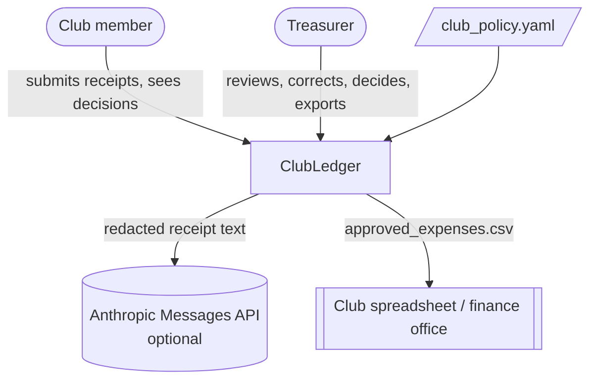
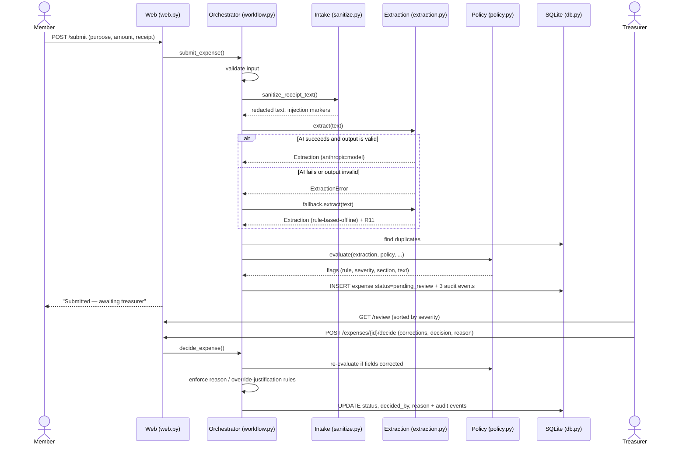
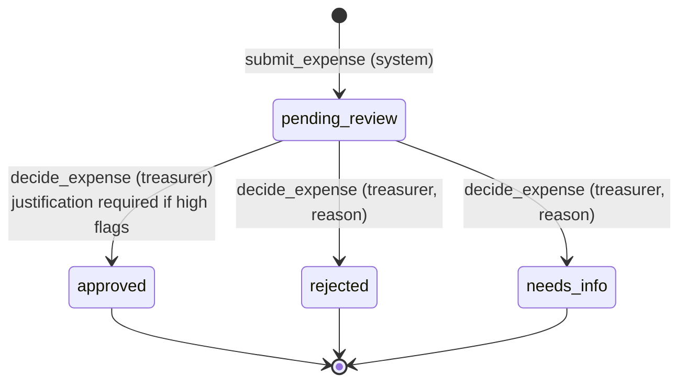

# Architecture and solution design

## Architectural style

ClubLedger is a **layered web application** with an **orchestrated agent pipeline** and a
**human-in-the-loop approval gate**:

- **Presentation layer:** Flask routes and Jinja templates (`web.py`, `templates/`).
- **Workflow (orchestrator) layer:** `workflow.py` runs each step in order and is the only place
  that changes an expense's status.
- **Processing steps ("agents" with bounded autonomy):**
  - *Intake controls* (`sanitize.py`): deterministic.
  - *Extraction agent* (`extraction.py`): an LLM proposes structured fields, with an offline fallback.
  - *Policy-compliance step* (`policy.py`): deterministic rules from `club_policy.yaml`.
- **Persistence layer:** SQLite (`db.py`) with an append-only audit table.

The AI component is deliberately narrow. It can only *propose* field values. It has no tools,
cannot call other components and cannot change state.

## Context

## Components and data flow

## Expense states

There is no transition out of `pending_review` that does not go through a treasurer.
Decided expenses are final, and the `UPDATE … WHERE status = 'pending_review'` guard prevents double decisions.

## Data model

**expenses:** id, submitted_by, submitted_at, purpose, claimed_amount, receipt_text (redacted),
redactions, extraction (JSON: the AI or reader proposal, never overwritten), flags (JSON),
recommendation, status, decided_by, decided_at, decision_reason, final_fields (JSON, after
corrections).

**audit_events:** id, expense_id, at (UTC), actor (a person's name or `system:<step>`), action,
details (JSON). UPDATE and DELETE are blocked by triggers.

Keeping `extraction` (what the machine proposed) separate from `final_fields` (what the human
confirmed) means the record always shows where the AI was wrong and what the treasurer changed.

## AI component design

| Aspect | Decision |
|---|---|
| Model | Claude via the Anthropic Messages API (`claude-haiku-5-5` by default, configurable). A small, fast model is enough for field extraction. |
| Call | Standard-library `urllib`, `temperature: 0`, `max_tokens: 800`, 20 s timeout |
| Prompt | The system prompt states the receipt is untrusted data, that the model must not follow instructions in it, that it does not judge expenses, and gives the exact JSON schema and category list. The receipt is wrapped in `<receipt>` tags, and any such tags inside the text are neutralized. |
| Output handling | Code fences are stripped, the JSON is parsed, then `validate_extraction_dict` checks types, ISO dates, total range (0–100,000), category against the policy list (else `other`), up to 100 line items and confidence clamped to 0–1 |
| Failure | Any network, timeout, envelope, JSON or schema error raises `ExtractionError`. The orchestrator then uses the offline reader and flags R11, and the error goes in the audit log. |
| Why not RAG or fine-tuning | The policy is short and handled by deterministic code. Extraction needs no external knowledge. Adding retrieval would add complexity without a measurable benefit. |

## Architecture decision records

**ADR-1: Deterministic policy engine instead of LLM judgment.**
*Context:* Spending rules decide whether money moves and are audited.
*Decision:* Implement checks as plain code driven by YAML.
*Consequences:* Predictable, unit-testable and cited. The trade-off is that unusual cases the
rules don't cover depend on the treasurer's judgment, which is acceptable because the treasurer
reviews everything.

**ADR-2: Structural human gate.**
*Decision:* Only `decide_expense()` writes non-pending statuses, and it requires a named treasurer.
A static test enforces this.
*Consequences:* Even a compromised or confused model cannot approve anything.

**ADR-3: Offline reader as default and fallback.**
*Decision:* Ship a regex/keyword reader and use it when no key is set or the AI fails.
*Consequences:* Free, reproducible demos and CI, plus graceful degradation. Its accuracy is
lower on messy receipts, which flag R6 makes visible.

**ADR-4: SQLite and server-rendered pages.**
*Decision:* No separate front-end framework or database server.
*Consequences:* One-command setup and low maintenance for a volunteer-run club. It is not
designed for many concurrent users, which is acceptable for one club.

**ADR-5: Redact before AI and before storage.**
*Decision:* Sanitize first, then do everything else.
*Consequences:* Sensitive numbers never leave the machine or persist. Rare false positives
(Luhn-valid order numbers) are accepted and visible as `[CARD ****nnnn]`.

**ADR-6: Override justification for high-severity flags.**
*Decision:* Approving despite high flags needs a 15+ character reason. It is logged with the
list of overridden rules.
*Consequences:* Keeps the treasurer's authority while making overrides deliberate and auditable.

## Planned vs. implemented

| Area | Planned solution | Implemented prototype |
|---|---|---|
| Input | Photo, PDF or text receipts | Text only (paste or `.txt`) |
| Extraction | LLM | LLM (Anthropic) + offline reader, with automatic fallback |
| Policy | Club and student-government rules | 11 rules, sample policy YAML |
| Users | University SSO, multiple treasurers and advisors | Name sign-in, single shared treasurer PIN |
| Output | Push to club finance sheet | CSV export |
| Hosting | Cloud deployment | Local run on the development server; production needs are listed under README → Known limitations |
